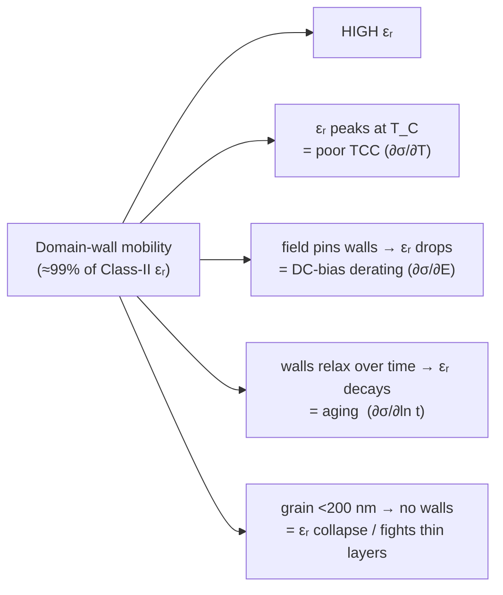

# Permittivity–Stability Trade-off

Raising the dielectric constant `εᵣ` is the most direct way to a higher-capacitance MLCC ([[mlcc-capacitance-equation]]), but **every point of `εᵣ` is paid for in stability** — temperature, DC-bias, time, and grain-size robustness all degrade *together* as `εᵣ` rises. This is not a coincidence or an engineering oversight: `εᵣ` and stability are **the same physics with opposite sign**, and the [[landau-devonshire-permittivity-model|single εᵣ(T,E,t) surface]] makes it exact — you cannot raise the surface without steepening its gradients.

## The root cause: high εᵣ is *borrowed* from domain-wall mobility

In a Class II [[batio3|BaTiO₃]] dielectric the permittivity is overwhelmingly **extrinsic**: it comes from the motion of [[ferroelectric-domain-wall|ferroelectric domain walls]], not from intrinsic ionic/electronic displacement. The arxiv Landau–Ginzburg study ([[arxiv-batio3-domain-wall-motion|Gurung et al. 2024]]) shows the **domain-wall contribution is ~2 orders of magnitude larger than the intrinsic part**. So of X7R's `εᵣ ≈ 3000` vs [[c0g-npo-dielectric|C0G]]'s `≈ 30`, ~99 % of that 100× is domain-wall response — which exists only because BaTiO₃ sits below its [[curie-temperature|Curie point]] in the tetragonal ferroelectric phase ([[cubic-tetragonal-transition]]).

The catch: *anything mobile is by nature labile.* Domain-wall mobility is sensitive along four axes, and each is one trade-off — equivalently, each is a gradient of the `σ = ln εᵣ` field ([[landau-devonshire-permittivity-model]]).

## The four axes, each from the same cause

**1. Temperature instability** ([[temperature-coefficient-of-capacitance|TCC]]). Domain-wall response is maximal at `T_C`, so the εᵣ peak *is* the Curie peak. Curie–Weiss gives `TCC = −εᵣ/C_cw` ([[landau-devonshire-permittivity-model]]): **|TCC| scales with εᵣ**. To flatten the temperature curve you must broaden/lower the peak ([[class-specific-tc-engineering]]) — i.e. spend εᵣ. [[y5v-z5u-class-iii-dielectric|Y5V]] keeps max εᵣ (~12000) and pays with +22/−82 % over temperature.

**2. DC-bias derating** ([[dc-bias-derating]]). A DC field pins the walls aligned with it; small-signal AC can no longer flip them, so εᵣ saturates downward. Johnson tunability scales as **εᵣ(0)³** — the more mobile-wall εᵣ you start with, the more there is to lose. An 0805 X7R 10 µF drops −35…−65 % at rated voltage ([[vishay-x7r-cap-drift-dc-bias]]); C0G has `f_V ≈ 1`. Because the variable is *field* `E = V/d`, thinning the dielectric for CV **compounds** the loss.

**3. Aging** ([[aging-class-2]]). After cooling through `T_C` the walls relax toward lower-energy pinned positions, so εᵣ decays logarithmically. The rate tracks the wall contribution: C0G ≈ 0, X7R 1–2 %/decade, X5R ~5 %, Y5V 5–7 %. Reversible by heating above `T_C` (re-randomises domains).

**4. Grain-size collapse — the axis that makes εᵣ fight thin layers.** Domain walls (esp. 90° twins) need a grain big enough to nucleate them and relieve the c/a≈1.01 strain. Below ~200 nm no twins form → strain is retained → c/a→1 → the grain reverts paraelectric and εᵣ crashes ([[cubic-tetragonal-transition]]; [[nano-grain-batio3-epsilon-r]]: ~5000–6000 at 1 µm → ~1000 at 100 nm; [[srep-batio3-grain-size-unfolding]]). Since thin layers force small grain (3-grains-per-layer rule), chasing thin-layer CV **destroys the ferroelectricity that supplies high εᵣ** — the [[nasa-batio3-mlcc-failure-mechanisms|~3000–4000 µF/cm³ volumetric-efficiency ceiling]], which caps the thin-dielectric lever in the [[mlcc-capacitance-equation|capacitance equation]].

## The proof by contrast: C0G

[[c0g-npo-dielectric|C0G/NP0]]: εᵣ ≈ 30, 0 ± 30 ppm/°C, no aging, `f_V ≈ 1`. It is **paraelectric — no domain walls** — so its polarisation is intrinsic ionic/electronic displacement, inherently field-, temperature-, time-, and size-independent. It is perfectly stable *because* it has no domain walls, and it has low εᵣ for the same reason. **You cannot get both high εᵣ and stability in this material system, because the high εᵣ *is* the instability.**

## The ladder — the trade made explicit

| Class | εᵣ | T_C placement | TCC | DC-bias loss | Aging | Root |
|---|---|---|---|---|---|---|
| [[c0g-npo-dielectric\|C0G]] | ~30 | none (paraelectric) | ±30 ppm/°C | ~0 | ~0 | no domains |
| [[x7r-dielectric\|X7R]] | ~3000 | ~125 °C (shoulder) | ±15 % | −35…−65 % | 1–2 %/dec | core-shell-tamed walls |
| X5R | ~3200 | ~120 °C | ±15 % (−55…+85) | worse (thinner/higher-CV) | ~5 %/dec | "" |
| [[y5v-z5u-class-iii-dielectric\|Y5V]] | ~12000 | ~25 °C (in range) | +22/−82 % | ~−90 % at rated | 5–7 %/dec | bare relaxor walls |

Every column worsens together as εᵣ rises — because they are the same domain-wall knob.

## The engineering escape (only partial): core-shell

[[core-shell-batio3]] is how Tier-1 BME parts cheat the trade: a **ferroelectric core** (εᵣ 3000–5000) wrapped in a **paraelectric shell** (εᵣ 100–500) that is temperature-flat and field-linear. The shell simultaneously broadens the Curie peak (TCC), cushions DC-bias, constrains domain re-orientation (aging), and traps oxygen vacancies (reliability). It is a literal "**spend some εᵣ to rent back stability**." Only partial because: (a) the shell dilutes the composite εᵣ; (b) thin layers still force small grain → less core; (c) it remains the live patent frontier (Murata/SEMCO dopant ratios, 2024–25) precisely because the trade is fundamental, not solved. [[polar-nanoregions-pnr|PNR/relaxor]] routes ([[class-specific-tc-engineering]]) are the other lever — flatten `f_V` and broaden `f_T` by replacing long-range order with nanoscale order.

## Net

εᵣ and stability are one quantity seen with opposite sign: domain-wall mobility is at once the source of high permittivity and of every instability. Engineers never *add* instability to gain εᵣ — the εᵣ they harvest is intrinsically labile, and every Class-II technique (core-shell, peak-shifters, relaxor broadening, graded compositions) spends part of that εᵣ to buy back a slice of temperature / field / time stability. The [[landau-devonshire-permittivity-model|single εᵣ(T,E,t) surface]] is why: you cannot raise the surface without steepening its gradients.

## Cross-references
- [[landau-devonshire-permittivity-model]] — the equation: one surface, three gradients
- [[mlcc-capacitance-equation]] — raising εᵣ is one of its levers; this is that lever's trade-off
- [[ferroelectric-domain-wall]] — the seat of the extrinsic εᵣ
- [[temperature-coefficient-of-capacitance]], [[dc-bias-derating]], [[aging-class-2]] — the three derating axes
- [[nano-grain-batio3-epsilon-r]], [[cubic-tetragonal-transition]] — the grain-size collapse
- [[core-shell-batio3]], [[class-specific-tc-engineering]] — the partial escapes
- [[eia-rs-198-dielectric-classes]] — the class ladder definitions
- [[curie-temperature]], [[batio3]]

## References
- [[arxiv-batio3-domain-wall-motion]] — extrinsic (domain-wall) εᵣ ≫ intrinsic
- [[nasa-batio3-mlcc-failure-mechanisms]] — volumetric-efficiency ceiling; (r̄/d) reliability
- [[srep-batio3-grain-size-unfolding]] — εᵣ vs grain size across sintering methods
- [[vishay-x7r-cap-drift-dc-bias]] — measured DC-bias / aging behaviour
